<picture>
  <source media="(max-width: 600px)" srcset="assets/header-mobile.svg">
  
</picture>

<b>机器人 · 仿真 · 传感器 · 嵌入式 · Linux</b>

## 关于我

你好，我是 **LAN-GER**。我在 MuJoCo 里调机械臂，也用嵌入式硬件采集压力信号。这里记录机械臂怎么动、传感器怎么读，以及如何把两者接到软件里。

## 项目精选

### [在 MuJoCo 里操控 B601-RS 机械臂](https://github.com/LAN-GER/reBot-B601-RS-for-mujoco_sim)

在浏览器里用滑杆和摇杆控制机械臂，观察逆运动学和重力补偿的效果。通过 Real-to-Sim 接口，还可以把真实机械臂的状态同步到仿真环境中。

### [配置 reBot B601-RS 的电机与零点](https://github.com/LAN-GER/reBot-B601-Parameter-Configuration-Skills)

把 Windows 下的初始化流程整理成可复用的 Skill，从准备环境、写入电机 ID，到逐个关节校准零点。

### [把触压变成一张热力图](https://github.com/LAN-GER/Flexible-Pressure-Sensor)

用 ESP32-C3 扫描 **16 × 32** 柔性压力阵列的 512 个感测点。数据经 USB 或 Wi-Fi 传到浏览器，同一次按压可以看成平面热力图，也可以看成三维高度图。

## 一起交流

遇到复现问题，或者想交流实现细节，可以在对应项目的 Issues 留言。

[机械臂仿真](https://github.com/LAN-GER/reBot-B601-RS-for-mujoco_sim/issues) · [参数配置](https://github.com/LAN-GER/reBot-B601-Parameter-Configuration-Skills/issues) · [压力传感器](https://github.com/LAN-GER/Flexible-Pressure-Sensor/issues)

## 贡献图贪吃蛇

<picture>
  <source media="(prefers-color-scheme: dark)" srcset="https://raw.githubusercontent.com/LAN-GER/LAN-GER/snake-assets/snake-dark.svg">
  
</picture>

